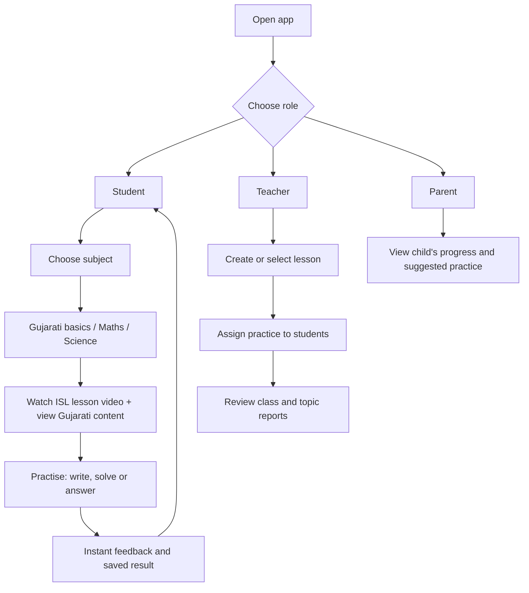
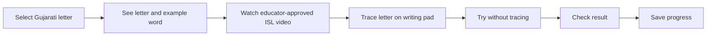
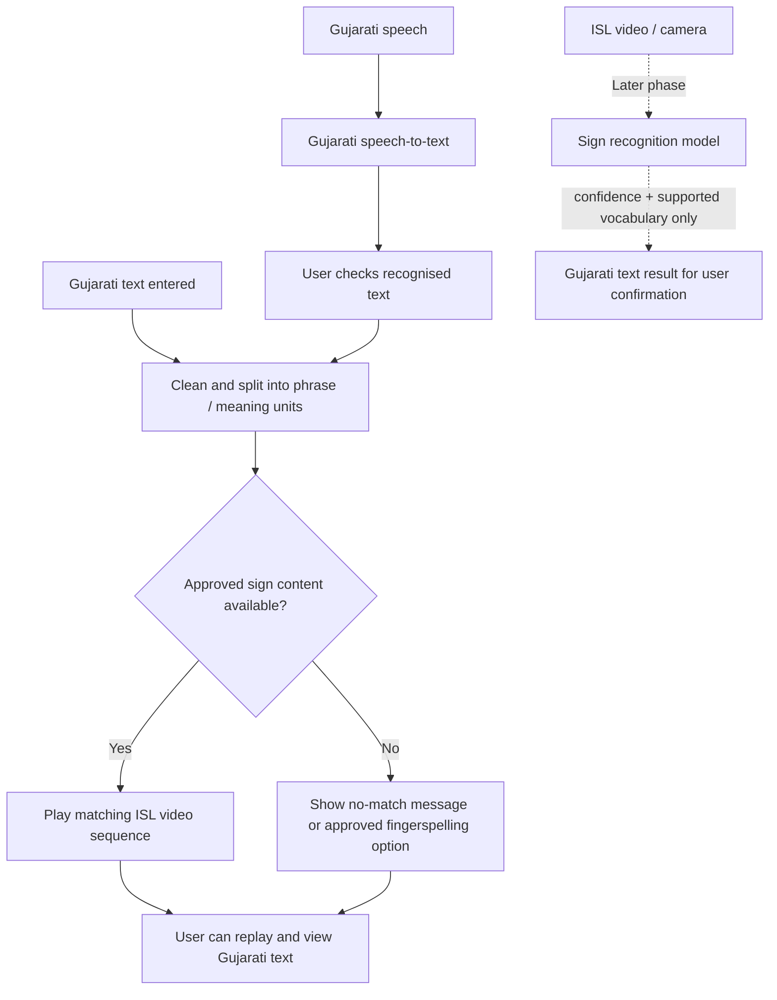
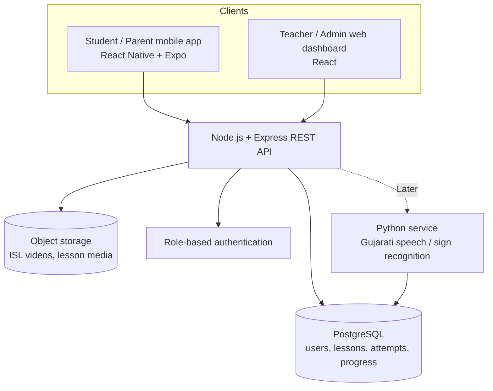
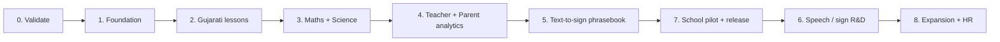

# Gujarati Inclusive Learning & Communication App

**Project roadmap | Government of Gujarat – Education Department brief**

## 1. Purpose

Build an accessible, Gujarati-first learning app that helps deaf and hard-of-hearing students practise school concepts beyond the classroom, while giving teachers and parents a shared view of learning progress. Add communication tools in stages so they are useful, safe, and accurate rather than promising unrestricted automatic translation too early.

**Primary users:** Students, teachers, parents.  
**Later user group:** Employers / HR teams for accessible interviews and workplace communication (deferred to Phase 8 Expansion).

### What makes this project valuable

India already has official Indian Sign Language (ISL) dictionary resources and the Sign Learn app. Our app should complement those resources with a focused Gujarati school-learning experience: lessons, writing practice, maths and science exercises, assignments, and progress reports. See the official [ISLRTC resources](https://divyangjan.depwd.gov.in/islrtc/) and [ISLRTC FAQ](https://islrtc.nic.in/faq/).

> **Important language decision:** ISL is a language, not a word-for-word code for Gujarati. A Gujarati word or sentence cannot safely be converted by simply replacing each word with a hand gesture. Use videos and mappings approved by Deaf ISL educators, preserve context, and record regional variants where needed. The ISLRTC FAQ describes regional variations and context-dependent signs, and says its dictionary videos are signed by Deaf signers.

---

## 2. Product scope: what we will build

| Module | Student experience | Teacher / parent experience | Priority |
|---|---|---|---|
| Gujarati basics | Alphabet and numbers lessons; sign video; example words; trace/write pad | Teachers add or assign lessons | **MVP** |
| Vocabulary | Common words starting with each Gujarati letter; simple sentences | Review content and practice results | **MVP** |
| Mathematics | Tables, addition, subtraction, multiplication, division; written problems | Assign exercises; view scores and weak topics | **MVP** |
| Science | Short concept lessons with sign videos, Gujarati text/visuals, and exercises | Assign lessons; monitor completion and scores | **MVP** |
| Learning analytics | Personal progress, attempts, completed lessons | Student report card, class progress, parent view | **MVP** |
| Gujarati text → ISL | Search and play expert-recorded signs for a limited, curated vocabulary and phrase set | Suggest or review new content | **MVP – limited phrasebook** |
| Gujarati speech → text → ISL | Convert recognised Gujarati speech into text, then show matching sign clips | Useful for supported phrases | **Later** |
| ISL video → Gujarati text | Camera-based recognition for a limited, trained vocabulary | Review uncertain results | **Later R&D** |
| HR communication | Live captions, text chat, and text-to-speech for interviews | Interviewer communication tools | **Later (Phase 8 Expansion)** |

**Do not promise in the first release:** translation of any arbitrary news article, unrestricted real-time Gujarati-to-ISL interpretation, or reliable recognition of every sign. These require large, consented datasets, contextual language handling, and validation with Deaf users and qualified ISL educators.

---

## 3. Main user flow

### Example: one Gujarati letter lesson

---

## 4. Communication converter flow

Start with a **curated phrasebook**, not open-ended machine translation. The same content library can power search, text conversion, and later speech conversion.

**Translation rule:** Display a clear “not supported” state when a reliable match is unavailable. Do not silently guess a sign or sentence meaning, and never fall back to unrelated signs. Actual sign recognition requires a trained, validated ML model; do not display simulated confidence scores or fabricate random voice responses.

---

## 5. Recommended technical architecture

Keep the first release simple. Build the learning product first; add machine-learning services only when there is a validated dataset and a clear use case.

| Layer | Suggested choice | Responsibility |
|---|---|---|
| Mobile app | React Native + Expo | Student and parent learning experience; Android-first pilot |
| Web dashboard | React | Teacher and content-admin screens (workplace/HR screens deferred to Phase 8) |
| Backend | Node.js + Express | Login, roles, lessons, assignments, attempts, reports, APIs |
| Database | PostgreSQL (managed Supabase is an option) | Structured learning and user data |
| Media storage | Supabase Storage or S3-compatible storage | Sign videos, diagrams, lesson media |
| ML / language services | Python service, added later | Gujarati speech recognition and bounded sign-recognition experiments |

**Core records to store:** User and role, student profile, lesson, subject/topic, sign-video asset, question, assignment, attempt, score, and progress summary.

---

## 6. Fixed implementation roadmap

Build in this order. Each phase should be demonstrated before moving to the next.

| Phase | What to build | Deliverable / exit check |
|---|---|---|
| **0. Validate the problem** | Speak with deaf students, parents, teachers, and Deaf ISL educators. Confirm grade level, Gujarati curriculum, preferred sign usage, devices, and connectivity. | Agreed MVP scope; content validation process; initial lesson list. |
| **1. UX and foundation** | App navigation, role-based login, student / teacher / parent views, database, video storage, accessible design system. | Users can sign in and reach the correct dashboard. |
| **2. Gujarati learning** | Alphabet and numbers catalogue, example words, sign-video lessons, writing pad, basic practice and scoring. | A learner can complete a Gujarati lesson and see saved progress. |
| **3. Maths and science** | Tables and four operations; Gujarati question sets; short science lessons with sign video, visuals, and exercises. | Student can complete subject exercises; attempts and scores are stored. |
| **4. Teacher and parent tools** | Create/select lessons, assign practice, view student reports, topic-wise strengths and weak areas, parent progress view. | Teacher can assign work and review a report; parent can view progress. |
| **5. Text-to-sign phrasebook** | Search a limited set of verified Gujarati words and useful phrases; show matching ISL video clips; handle unavailable phrases clearly. | Search works for the approved starter vocabulary; every clip has a reviewer/source. |
| **6. Speech and sign R&D** | Gujarati speech-to-text feeding the phrasebook; then collect a consented sign-video dataset and test recognition on a limited vocabulary. | Measured test results, confidence handling, and user-confirmed output—not an unrestricted translator. |
| **7. Pilot and release** | Pilot with a small school group; fix usability issues; test on low-cost Android devices; add video compression, offline lesson caching, backups, and privacy controls. | Pilot feedback addressed; release checklist signed off by teachers and Deaf reviewers. |
| **8. Expansion** | More Gujarati content, additional science topics, article summarisation into reviewed sign segments, HR captions/text-to-speech module. | New modules released only after user testing and content review. |

### Roadmap at a glance

---

## 7. MVP release checklist

The first usable release is complete when:

- [ ] Student, teacher, and parent roles work with appropriate permissions (educational roles only; HR role deferred to Phase 8).
- [ ] Gujarati alphabet and numbers have reviewed learning content and sign videos.
- [ ] Each Gujarati lesson includes an example word and a writing-pad exercise.
- [ ] Maths includes tables, all four basic operations, and written practice problems.
- [ ] Science includes a starter set of concept lessons, visuals, sign videos, and questions.
- [ ] Teachers can assign work and view scores; parents can view student progress.
- [ ] Students can search the starter Gujarati-to-ISL phrasebook and replay videos.
- [ ] Progress is saved reliably, and the app is tested with actual students and educators.
- [ ] Video consent, content attribution, user privacy, and deletion processes are documented.

**Suggested first content batch:** Start small (for example, one complete alphabet/number set, 30–50 high-frequency words, a few sentence patterns, core arithmetic practice, and 5–10 science concepts). Expand based on classroom feedback rather than filling the app with unreviewed content.

## 8. Quality and inclusion rules

1. **Co-design with Deaf users:** Deaf learners and qualified Deaf ISL signers should review lessons and conversion content before release.
2. **Use video-first instruction:** Show the signer clearly, with consistent framing, good lighting, captions, replay, and adjustable playback speed.
3. **Respect language variation:** Record the source, reviewer, meaning, context, and any regional variant for each sign clip.
4. **Make audio optional:** Every essential instruction must be understandable through sign, text, or visuals; speech output is an additional aid.
5. **Protect learners:** Obtain consent for recorded video, collect only necessary data, use role-based access, and avoid exposing student reports publicly.
6. **Measure learning, not just app usage:** Track lesson completion, question accuracy, attempts, and improvement by topic.

---

## 9. Useful official starting points

- [ISLRTC – Indian Sign Language resources and dictionary](https://divyangjan.depwd.gov.in/islrtc/)
- [ISLRTC – FAQ, dictionary features, regional variation, and use conditions](https://islrtc.nic.in/faq/)
- [ISLRTC – Dictionary page](https://islrtc.nic.in/isl-dictionary/)
- [Government of India – Open Government Data entry for the ISL Dictionary](https://data.gov.in/catalog/indian-sign-language-dictionary)

**Content-use note:** The ISLRTC FAQ states conditions for using its dictionary for teaching or technology development, including acknowledgement and no resale/profiteering from that data. Review the current terms and obtain any required permission before importing, redistributing, or training on official dictionary assets. Creating original, consented Gujarati learning videos with Deaf ISL educators is a strong way to build project-specific content.

---

**North-star outcome:** A student should be able to open the app at home, learn a Gujarati concept through clear ISL-supported content, practise independently, and see progress—while teachers and parents can support the same learning journey.
